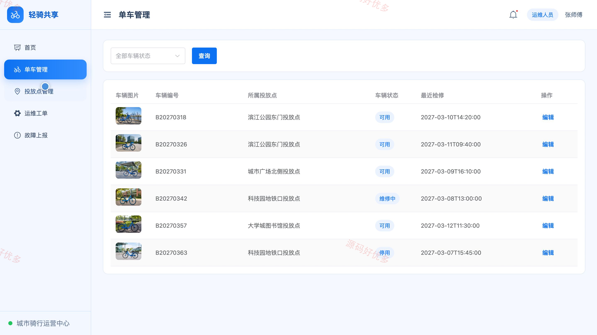
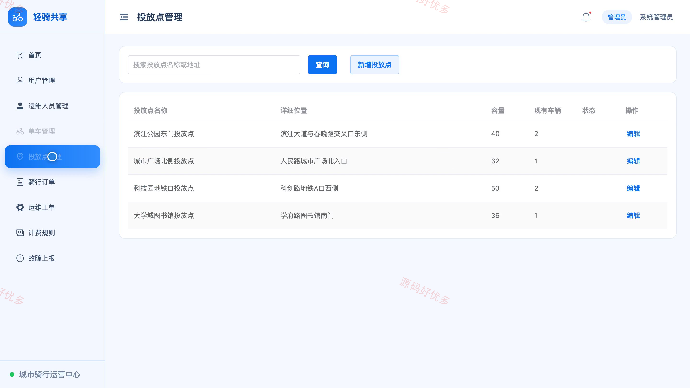

# bs023B
bs023B共享单车小程序源码 Java SpringBoot3 Vue3 设计文档 PPT
## 源码问题查看主页咨询

### 一、关键词
共享单车、单车租赁、骑行服务、车辆调度、故障报修

### 二、作品包含
源码+数据库+万字设计文档+PPT+全套环境和工具资源+本地部署教程

### 三、项目技术
前端技术： Html、Css、Js、Vue3.4、Element-Plus、uniapp
后端技术：Java、SpringBoot3.2.0、MyBatis-Plus

### 四、运行环境要求
开发工具：IDEA/eclipse + VSCODE + HBuilder X + 微信开发者工具

数据库：MySQL5.7+（共14张表）

数据库管理工具：Navicat10以上版本

环境配置软件： JDK17 + Maven3.6

前端Nodejs：16+

浏览器：谷歌浏览器

### 五、项目介绍
项目编号：bs023B

共享单车小程序为骑行用户、运维人员和管理员提供车辆查询、用车还车、计费结算与故障处理服务。骑行用户通过小程序完成用车全流程，运维人员负责单车、投放点和工单处理，管理员统一管理账号、订单与计费规则。

角色：骑行用户、运维人员、管理员

骑行用户功能：小程序登录与注册、单车及投放点查询、开始用车与还车结算、骑行订单与详情查看、账户充值、单车故障上报、通知及个人资料维护。

运维人员功能：管理端登录与工作台、单车信息管理、投放点管理、运维工单管理、故障上报处理、个人资料维护。

管理员功能：管理端登录与工作台、骑行用户与运维人员管理、单车与投放点管理、骑行订单管理、运维工单与故障管理、计费规则管理、个人资料维护。

### 六、运行截图

